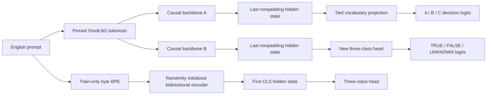
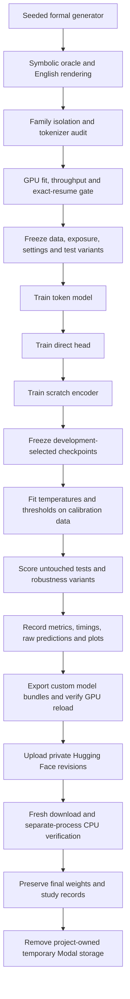

# Decision Model Lab architecture

Every model receives the same English facts, rules, question, and answer mapping. Labels and oracle proofs are metadata used for training and evaluation; they are not embedded in the model input.

A and B start independently from the same pinned pretrained backbone. Both update its full weights. A trains with full-vocabulary cross-entropy and additionally reports unrestricted invalid answers. B trains with three-class cross-entropy. C uses established transformer components and learns this task from random initialization; it is not general language pretraining.

Temperature scaling operates on the three class logits after training. It changes confidence, not the selected class. A confidence threshold may defer any class, including UNKNOWN. UNKNOWN itself means neither the queried statement nor its explicit negation is derivable.

## Study sequence

Modal runs bounded batch Functions, one GPU call at a time. The laptop controls calls, keeps the invocation ledger, runs approved CPU tests, and uploads verified artifacts. The Hugging Face write token stays on the laptop.

## Recovery and selection

Recovery checkpoints store weights, Adam moments, scheduler state, data cursor, example counts, and Python/Torch RNG states. Files are checksummed before a checkpoint is marked complete. The controller links each chunk to its parent checkpoint and retains two recent recovery points.

Selection uses development three-class NLL, with accuracy breaking an exact tie. It does not use calibration or test results. Final weights are retained even when a previous development checkpoint is selected.

Once test evaluation starts, the training wrapper rejects further training for that study. Evaluation validates the frozen weights, calibration, baseline configuration, test inputs, and evaluation source before scoring. A later experiment needs a new declared protocol.

## Interpreting the comparison

A versus B compares output layers and loss objectives on the same pretrained backbone and exposure. C differs in initialization, parameter count, tokenizer, and attention pattern; its result cannot isolate pretraining alone. All conclusions are limited to a single seed and the generated rule distributions. See the result and learning reports for measured behavior.
