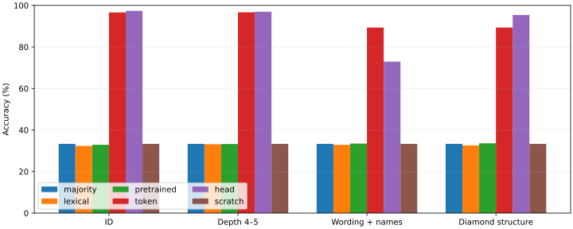
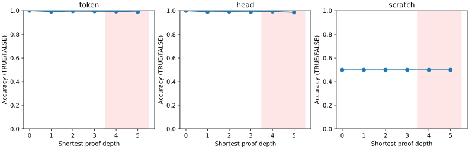
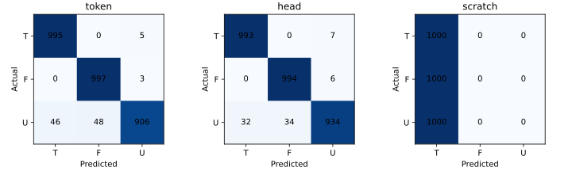
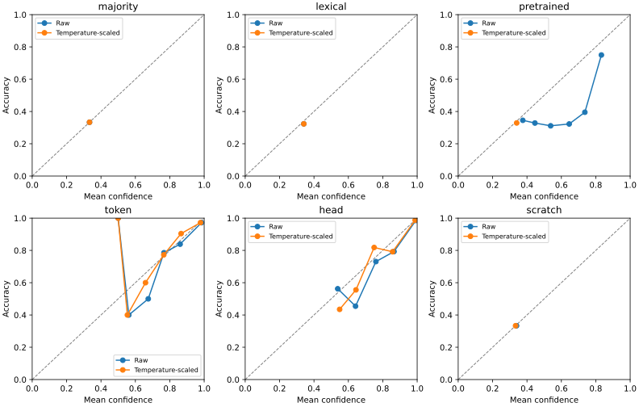
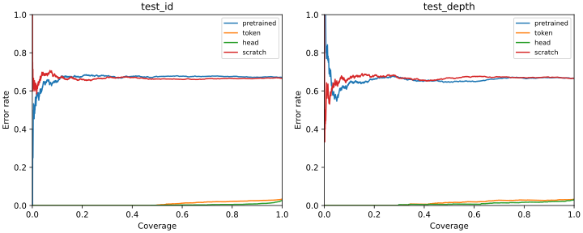
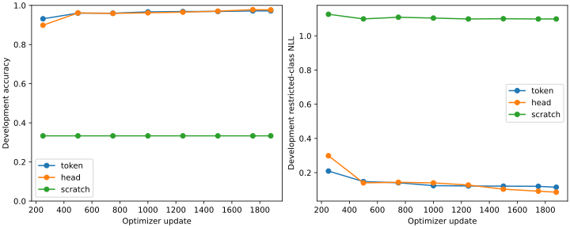

# Decision Model Lab: v1 results

The fine-tuned models learn the original benchmark, but neither is a reliable rule-decision engine. Both retain the wrong original label on every one of 142 counterfactual questions where a flipped premise destroys derivation support. See [FAILURE_ANALYSIS.md](FAILURE_ANALYSIS.md) for the verified breakdown and example.

The head slightly improves ID accuracy and structure transfer; the token model transfers much better to changed wording and names. Scratch remains at chance under the frozen three-pass protocol. The head has no demonstrated inference-speed advantage.

A single-seed study of three-class reasoning over supplied facts and explicit rules. TRUE means derivable, FALSE means the explicit negation is derivable, and UNKNOWN means neither. Abstention is a separate confidence-based policy.

## Held-out accuracy

| Model | ID | Depth 4–5 | Wording + names | Diamond structure |
| --- | ---: | ---: | ---: | ---: |
| majority | 33.33% | 33.33% | 33.33% | 33.33% |
| lexical | 32.33% | 33.13% | 32.87% | 32.60% |
| pretrained | 32.90% | 33.27% | 33.47% | 33.60% |
| token | 96.60% | 96.67% | 89.33% | 89.33% |
| head | 97.37% | 96.93% | 72.93% | 95.40% |
| scratch | 33.33% | 33.33% | 33.33% | 33.33% |

The proof-depth plot excludes UNKNOWN because it has no proof. Depths 0–3 come from ID tests and depths 4–5 from the deeper test pool; these are separate family distributions.

## Answerable versus UNKNOWN

| Model | Split | TRUE/FALSE accuracy | UNKNOWN accuracy |
| --- | --- | ---: | ---: |
| token | test_id | 99.60% | 90.60% |
| token | test_depth | 99.20% | 91.60% |
| head | test_id | 99.35% | 93.40% |
| head | test_depth | 99.00% | 92.80% |
| scratch | test_id | 50.00% | 0.00% |
| scratch | test_depth | 50.00% | 0.00% |

## ID reliability

| Model | Macro F1 | Raw NLL | Cal NLL | Raw ECE | Cal ECE | Cal Brier |
| --- | ---: | ---: | ---: | ---: | ---: | ---: |
| pretrained | 0.2609 | 1.1825 | 1.0989 | 0.1368 | 0.0111 | 0.6668 |
| token | 0.9656 | 0.1288 | 0.1240 | 0.0138 | 0.0083 | 0.0619 |
| head | 0.9735 | 0.0845 | 0.0819 | 0.0098 | 0.0048 | 0.0422 |
| scratch | 0.1667 | 1.0988 | 1.0986 | 0.0060 | 0.0003 | 0.6667 |
| majority | 0.1667 | 1.0986 | 1.0986 | 0.0000 | 0.0000 | 0.6667 |
| lexical | 0.3222 | 1.0989 | 1.0989 | 0.0175 | 0.0175 | 0.6668 |

Brier scores sum squared errors over all three classes. ECE uses 10 equal-width bins. AURC averages risk at retained counts 1..N; stable input order breaks confidence ties. The local evaluation JSON contains full bin counts, confusion matrices, risk–coverage curves, and abstention results.

## Confidence under distribution shift

| Model | Split | Cal NLL | Cal ECE | Cal AURC | Wrong with confidence ≥90% |
| --- | --- | ---: | ---: | ---: | ---: |
| token | test_id | 0.1240 | 0.0083 | 0.0094 | 79 |
| token | test_depth | 0.1350 | 0.0083 | 0.0141 | 41 |
| token | test_wording | 0.3983 | 0.0424 | 0.0397 | 82 |
| token | test_structure | 0.3812 | 0.0570 | 0.0549 | 99 |
| head | test_id | 0.0819 | 0.0048 | 0.0031 | 37 |
| head | test_depth | 0.1168 | 0.0082 | 0.0084 | 29 |
| head | test_wording | 0.9106 | 0.2006 | 0.1108 | 248 |
| head | test_structure | 0.1429 | 0.0082 | 0.0091 | 29 |
| scratch | test_id | 1.0986 | 0.0003 | 0.6659 | 0 |
| scratch | test_depth | 1.0986 | 0.0003 | 0.6662 | 0 |
| scratch | test_wording | 1.0986 | 0.0003 | 0.6757 | 0 |
| scratch | test_structure | 1.0986 | 0.0003 | 0.6577 | 0 |

## Deferral with calibration-selected thresholds

Each cell is achieved test coverage / error rate among retained answers. The column's target is chosen on calibration data. All predictions tied at a threshold are retained, so achieved coverage can exceed its target; a flat-confidence baseline can retain every answer.

| Model | Split | Target 50% | Target 75% | Target 90% |
| --- | --- | ---: | ---: | ---: |
| majority | test_id | 100.00% / 66.67% | 100.00% / 66.67% | 100.00% / 66.67% |
| pretrained | test_id | 50.27% / 67.44% | 77.43% / 67.54% | 91.40% / 67.21% |
| pretrained | test_depth | 40.60% / 65.52% | 66.73% / 66.23% | 84.40% / 66.75% |
| pretrained | test_wording | 37.33% / 66.79% | 70.60% / 65.82% | 91.60% / 66.59% |
| pretrained | test_structure | 45.60% / 66.08% | 74.60% / 66.76% | 91.07% / 66.03% |
| token | test_id | 49.73% / 0.20% | 74.97% / 1.96% | 88.83% / 2.48% |
| token | test_depth | 34.47% / 0.77% | 69.40% / 2.69% | 86.60% / 2.69% |
| token | test_wording | 48.67% / 4.93% | 58.93% / 5.88% | 70.60% / 6.42% |
| token | test_structure | 34.87% / 6.12% | 59.93% / 8.01% | 70.80% / 8.10% |
| head | test_id | 49.30% / 0.07% | 72.47% / 0.46% | 89.57% / 0.82% |
| head | test_depth | 32.33% / 0.41% | 60.07% / 0.67% | 84.07% / 1.74% |
| head | test_wording | 49.73% / 9.79% | 56.93% / 14.17% | 67.13% / 18.57% |
| head | test_structure | 30.67% / 0.22% | 59.93% / 1.11% | 82.87% / 1.61% |
| scratch | test_id | 48.00% / 66.32% | 74.33% / 66.46% | 89.33% / 66.60% |
| scratch | test_depth | 52.00% / 66.41% | 75.87% / 67.05% | 93.33% / 67.29% |
| scratch | test_wording | 47.53% / 68.86% | 74.40% / 66.31% | 93.67% / 66.55% |
| scratch | test_structure | 57.47% / 65.20% | 80.80% / 66.09% | 95.07% / 66.48% |

## Token-output validity

| Model | Split | Restricted accuracy | Unrestricted accuracy | Invalid answers | Outside mass |
| --- | --- | ---: | ---: | ---: | ---: |
| pretrained | test_id | 32.90% | 23.33% | 31.87% | 0.6191 |
| pretrained | test_depth | 33.27% | 26.20% | 20.53% | 0.5681 |
| pretrained | test_wording | 33.47% | 13.27% | 62.00% | 0.6628 |
| pretrained | test_structure | 33.60% | 28.07% | 19.07% | 0.5540 |
| token | test_id | 96.60% | 96.57% | 0.00% | 0.0000 |
| token | test_depth | 96.67% | 96.60% | 0.00% | 0.0000 |
| token | test_wording | 89.33% | 89.27% | 0.00% | 0.0001 |
| token | test_structure | 89.33% | 88.93% | 0.00% | 0.0000 |

Unrestricted accuracy treats any vocabulary token outside A/B/C as an error. Restricted scores renormalize probabilities over A/B/C; these answer different questions and are shown separately.

## Family uncertainty

- token_minus_head_accuracy: -0.0077; 95% family-bootstrap interval [-0.0130, -0.0027].
- token_minus_head_nll: 0.0443; 95% family-bootstrap interval [0.0288, 0.0607].
- token_depth_drop: -0.0007; 95% family-bootstrap interval [-0.0120, 0.0103].
- head_depth_drop: 0.0043; 95% family-bootstrap interval [-0.0067, 0.0157].
- scratch_depth_drop: 0.0000; 95% family-bootstrap interval [0.0000, 0.0000].

Token-versus-head comparisons resample the same theory families for both models. ID-versus-depth drops resample the two disjoint family pools independently. These intervals measure test-family sampling uncertainty, not training-seed stability.

## Robustness

| Model | Transformation | Accuracy | Same-label consistency | Changed-label accuracy |
| --- | --- | ---: | ---: | ---: |
| token | rename | 88.67% | 91.00% | — |
| token | reorder | 97.33% | 99.67% | — |
| token | irrelevant | 96.67% | 99.00% | — |
| token | paraphrase | 88.00% | 88.33% | — |
| token | remove_premise | 70.33% | 100.00% | 59.00% |
| token | flip_fact | 50.33% | 100.00% | 29.00% |
| head | rename | 86.67% | 88.00% | — |
| head | reorder | 96.67% | 98.00% | — |
| head | irrelevant | 97.67% | 98.33% | — |
| head | paraphrase | 79.33% | 79.33% | — |
| head | remove_premise | 69.00% | 98.00% | 55.50% |
| head | flip_fact | 51.00% | 99.00% | 29.00% |
| scratch | rename | 33.33% | 100.00% | — |
| scratch | reorder | 33.33% | 100.00% | — |
| scratch | irrelevant | 33.33% | 100.00% | — |
| scratch | paraphrase | 33.33% | 100.00% | — |
| scratch | remove_premise | 0.00% | 100.00% | 0.00% |
| scratch | flip_fact | 9.67% | 100.00% | 14.50% |

Each transformation uses 100 eligible held-out families and three questions per family. The oracle recomputes labels after premise deletion and fact changes. Consistency can include wrong answers; accuracy is reported separately. Paraphrases were mechanically checked against the formal source without independent human review.

## Inference measurements

| Model | B1 median (ms) | B1 p95 (ms) | B32 decisions/s | B32 cost / 1,000 |
| --- | ---: | ---: | ---: | ---: |
| pretrained | 42.36 | 50.09 | 179.9 | $0.001920 |
| token | 43.47 | 45.36 | 179.6 | $0.001924 |
| head | 43.18 | 45.11 | 175.2 | $0.001972 |
| scratch | 5.03 | 5.34 | 6450.0 | $0.000054 |

Benchmarks use the same 500 semantic inputs selected before scoring, one L4, BF16 autocast, GPU synchronization, 20 warmups, and fixed batch padding. Batch-1 measures 500 forward passes; batch-32 uses 480 requests in full batches. Forward timings exclude tokenization and transfers; tokenization is reported separately. Costs use requested L4 + 4 physical CPU cores + 32 GiB RAM rates. Model loading is separate; platform cold-start and queuing are not isolated. See [Modal pricing](https://modal.com/pricing). These are not reconciled invoice costs.

| Model | B1 mean preparation (ms) | B32 preparation (s) | Model loading (s) |
| --- | ---: | ---: | ---: |
| pretrained | 0.345 | 0.0568 | 2.25 |
| token | 0.358 | 0.0569 | 1.87 |
| head | 0.351 | 0.0582 | 1.67 |
| scratch | 0.285 | 0.0545 | 0.24 |

Preparation includes allocation, padding, and host-to-device copies; it is measured separately from forward computation. Tokenization precedes both. These are warm inference measurements, not end-to-end API latency.

| Model | CPU tokenization of 3,000 ID prompts (s) | Benchmark token range | Forward peak GPU GiB | B1 cost / 1,000 |
| --- | ---: | --- | ---: | ---: |
| pretrained | 0.4963 | 159–177 | 2.235 | $0.014961 |
| token | 0.3249 | 159–177 | 2.235 | $0.015086 |
| head | 0.3581 | 159–177 | 2.148 | $0.014945 |
| scratch | 0.3357 | 132–153 | 0.154 | $0.001750 |

Tokenization timing covers the full ID pool, while forward timing covers the 500 frozen benchmark prompts. It cannot be directly added to benchmark forward duration. Model size, different tokenizer lengths, and output projection all affect the scratch comparison. Phase dispatch/worker timings are in [COSTS_AND_RELEASES.md](COSTS_AND_RELEASES.md).

## Training and accounting

| Model | Worker seconds | Peak allocated GPU GiB | Selected development NLL |
| --- | ---: | ---: | ---: |
| token | 2697.4 | 6.900 | 0.114707 |
| head | 2667.9 | 6.904 | 0.085783 |
| scratch | 184.0 | 0.657 | 1.098746 |

Worker seconds include setup, updates, development scoring, and checkpoint serialization. They exclude platform startup/queue time and the subsequent Volume commits, so they are not total billable GPU duration.
Only successfully returned chunks contribute to that table; failed calls remain in the invocation ledger and the provider's app-level billing records.

- token: 361,821,120 parameters; 60,003 examples; 10,152,951 input tokens; 1,878 optimizer updates; selected step 1878; temperature 1.1482.
- head: 361,824,003 parameters; 60,003 examples; 10,152,951 input tokens; 1,878 optimizer updates; selected step 1878; temperature 1.1674.
- scratch: 13,991,043 parameters; 60,003 examples; 8,561,049 input tokens; 1,878 optimizer updates; selected step 1750; temperature 20.0000.

Primary seed: 17. Each model completed three passes over 20,001 training questions. The conservative cumulative invocation allocation, including $1 for the initial pilots, is $13.15. This is a timeout-based planning allocation. The final observed workspace summary shows $2.77152523 metered usage and $0 billed; the app-level view totals $2.72688182 and has a small unresolved aggregation difference. All research jobs stopped and the temporary Volume was deleted after artifact retention checks. See [COSTS_AND_RELEASES.md](COSTS_AND_RELEASES.md) for the dated reconciliation, raw views, and possible delayed storage accounting.

Frozen protocol: `b622cfa2d34eb2fb779a4692ceb69290e053d1dcd1b307da68d203bbd25f4d3e`. Calibration and checkpoint freeze: `b7104a02b532aae75ccb59ee882f46e5831449e86633638f7b33162bc9dd074f`. Selected weights, temperatures, thresholds, test variants, and performance input IDs were fixed before test scoring.

## Limits and artifacts

This experiment tests synthetic, bounded rule reasoning. It does not establish general decision ability. The token and direct-head approaches differ in output layer and loss objective; the new head also uses a 1e-4 learning rate while the shared backbones and token projection use 2e-5. The scratch comparison also differs in model size, tokenizer, and encoder architecture. One seed cannot establish training stability. In-distribution calibration does not guarantee OOD calibration.

Model artifacts contain FP32 safetensors, custom code, tokenizer, calibration, protocol, evaluation metrics, license attribution, and fixed loading checks. All three private Hugging Face releases passed fresh pinned-download checksum and CPU prediction checks after their GPU reload checks. [COSTS_AND_RELEASES.md](COSTS_AND_RELEASES.md) lists exact revisions. Implementation and reports remain local and uncommitted.

## Scope and pilot notes

The final preset uses 3–5 entities, 4–8 extra facts, an actual 514-entry scratch tokenizer inside an 8,192-slot embedding, and microbatch 16 for every architecture after the throughput gate. The common exposure cap remained three passes. Only seed 17 was run; the optional second seed and external RuleTaker test were not run. Paraphrase review and isolated platform cold-start/pure-transfer measurements remain limitations; model loading, tokenization, and preparation including copies were measured separately. Dispatch-to-worker timings include queueing and startup, and are recorded in the phase timing JSON files.

The first 40-step pilot did not establish full tiny-set fit; a 120-step pilot then fit both pretrained approaches to 100%. The scratch gate fit its 32 examples to 100% in 400 steps. These were wiring checks, not final test results. See GPU_PILOT.md and runs/study-v1/gate-*.json for retained measurements.

A local DNS disconnect canceled a head call after its 1,250-update development check but before a complete recovery save. The first retry collided with its orphaned selection directory. That orphan was preserved under a diagnostic filename and the conflicting path cleared. Both retries started from the verified 1,000-update recovery. Two failed 250-update attempts added 500 executed updates and 16,000 example presentations that are absent from the final learned trajectory. The selected final model still received the same 60,003-example exposure as the other models. One additional head call was explicitly allowed beyond the original nine-call operational cap. The scientific protocol, $20 compute limit, and $10 reserve were unchanged. See operational-invocation-amendment.json and interruption.json in the local study records. The completed 250-update replay reproduced byte-identical selected safetensors; replayed-checkpoint-verification.json records that comparison.
