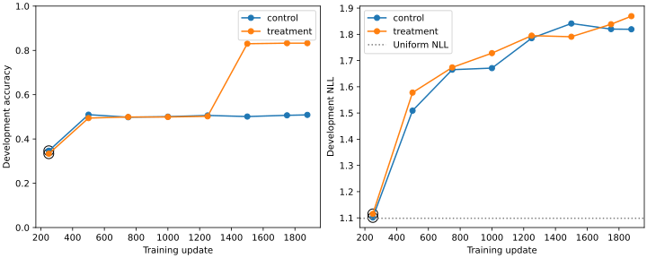

# V2: one question, three worlds

This example is development family `v2-development-000001`, selected before final test scoring: the first family in sorted order with an unchanged query across worlds and a two-step answerable proof. It is a semantic walkthrough, not evidence about the models' internal reasoning.

## Supported world

```text
Decide using only these facts and rules. TRUE means the statement follows; FALSE means its explicit negation follows; UNKNOWN means neither follows. Absence is not negation. Answer A for TRUE, B for FALSE, or C for UNKNOWN.

Facts:
Dalia is not ready.
Chen is not trusted.
Evan is not registered.
Evan is not active.
Chen supports Evan.
Gabe is enabled.
Dalia is enabled.
Evan is not verified.

Rules:
Whenever person 1 supports person 2 and person 2 is not active, person 1 is not verified; this applies to all people mentioned.
Whenever person 1 is not verified and person 1 is trusted, person 1 is not registered; this applies to all people mentioned.
Whenever person 1 is not verified and person 1 is not trusted, person 1 is registered; this applies to all people mentioned.

Statement: Chen is registered.

Answer:
```

Oracle: TRUE.

- Given: Chen supports Evan.
- Given: Evan is not active.
- Derive: Chen is not verified.
- Given: Chen is not trusted.
- Derive: Chen is registered.

## FALSE world

The statement stays “Chen is registered.” and the rules stay identical.

- Remove: Chen is not trusted.
- Add: Chen is trusted.

- Given: Chen supports Evan.
- Given: Evan is not active.
- Derive: Chen is not verified.
- Given: Chen is trusted.
- Derive: Chen is not registered.

## UNKNOWN world

The statement stays “Chen is registered.” and the rules stay identical.

- Remove: Evan is not active.
- Add: Evan is active.

- Neither the query nor its explicit negation occurs in the derived closure.

## What this comparison tests

The control sees only the supported original world and changes the query to obtain FALSE or UNKNOWN. The treatment must recognize a changed answer with the same query and rules. TRUE/FALSE branch selection is distinct from checking that the supporting chain is valid. A model can learn the first and still fail the second.

Training cross-entropy rewards the correct class independently on each prompt; we have not added a pairwise loss or a new architecture. All-three-world test correctness checks whether the learned function respects these related worlds after training.

## Why selection uses NLL

The control development check at update 250 had 34.68% accuracy and NLL 1.1015. At update 500, accuracy increased to 50.97% while NLL worsened to 1.5089. Cross-entropy penalizes confidently wrong predictions, so a higher-accuracy checkpoint can still lose the predeclared selection comparison. These are development measurements, not final test results.

The shared protocol gives both arms the same maximum exposure and selection rule. It does not force their selected checkpoints to have the same number of updates. Final reporting must distinguish completed-run exposure from the exposure of the exported selected weights.

The treatment also reached 49.43% development accuracy at update 500 with NLL 1.5778, worse than its update-250 NLL of 1.1153. Development contains both query constructions; each training arm contains only its assigned construction. The common selection rule therefore rewards performance across a broader distribution than either arm's training inputs. A low training loss alone cannot establish that either selected model learned transferable premise validity.

## The late learning and selection discrepancy

At the final update, treatment development accuracy reached **83.26%**, compared with control's **50.87%**. Their raw NLL values were 1.8693 and 1.8193. Both selected update 250: **8,000 presentations** in the selected weights, versus **60,003** in each completed trajectory. Their selected exposure therefore matches in this run.



The outlined points mark selected checkpoints. Uniform three-class probabilities have NLL `ln(3) = 1.0986`; late checkpoints can classify many more examples correctly while assigning very low probability to their mistakes. Raw NLL legitimately penalizes those errors. Selection happened before temperature calibration, so later calibration cannot recover a checkpoint that selection already discarded.

This is a metric and distribution issue to investigate, not permission to replace the selected models after inspecting tests. A future declared study could compare selection by raw NLL with development-only calibrated NLL or accuracy, then evaluate on new reserved families. The final weights are retained locally for such diagnostics. Their development accuracy is not a held-out test result.

## Actual selected and final model decisions

The following CPU FP32 demonstration uses the same development family chosen before test scoring. It is one example, not a new test accuracy estimate. Selected probabilities use their frozen temperatures; final-weight probabilities are uncalibrated. The aggregate test report evaluates only the preselected checkpoints in GPU BF16.

| World / oracle | Control selected | Treatment selected | Control final | Treatment final |
| --- | --- | --- | --- | --- |
| TRUE | TRUE | TRUE | TRUE | TRUE |
| FALSE | TRUE | TRUE | TRUE | FALSE |
| UNKNOWN | TRUE | TRUE | TRUE | UNKNOWN |

The final treatment distinguishes all three worlds in this example, while both selected heads answer TRUE throughout. This demonstrates why selecting an early checkpoint can hide later learning. It does not establish generalization of the final weights beyond this development example. Exact logits, probabilities, example IDs, and weight hashes are retained in `runs/study-v2/worked-example-predictions.json`.
