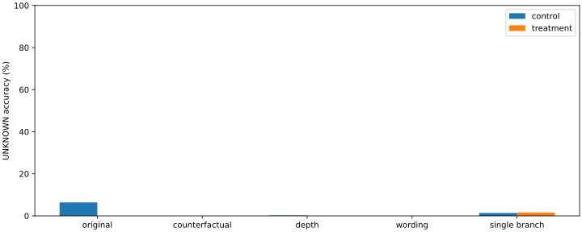
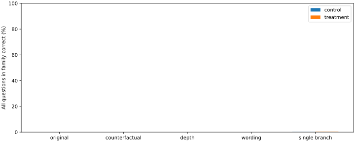

# V2: changed-premise training results

**The selected models did not solve premise validity.** Both predict TRUE on all 3,000 counterfactual test questions: 33.33% overall accuracy, 0/1,000 UNKNOWNs correct, and 0/1,000 complete three-world families correct. The data intervention produced no primary improvement under the frozen selection protocol.

Primary UNKNOWN accuracy difference, treatment minus control: **0.00%**; 95% paired parent-family bootstrap interval [0.00%, 0.00%].

This is one training seed. The interval measures test-family sampling uncertainty, not seed stability. The primary test holds the same question fixed across TRUE, FALSE, and UNKNOWN worlds. All-three-world correctness distinguishes premise-sensitive decisions from a constant UNKNOWN answer.

## Held-out accuracy

| Suite | Control | Treatment | UNKNOWN control | UNKNOWN treatment |
| --- | ---: | ---: | ---: | ---: |
| test_original | 35.47% | 33.33% | 6.40% | 0.00% |
| test_counterfactual | 33.33% | 33.33% | 0.00% | 0.00% |
| test_depth | 33.27% | 33.33% | 0.20% | 0.00% |
| test_wording | 33.67% | 33.33% | 0.00% | 0.00% |
| test_single_branch | 25.90% | 26.20% | 1.40% | 1.60% |

## Family correctness and confidence

| Suite | Model | All-family correct | Cal NLL | Cal ECE | Wrong at ≥90% confidence |
| --- | --- | ---: | ---: | ---: | ---: |
| test_original | control | 0.00% | 1.0924 | 0.0020 | 0 |
| test_original | treatment | 0.00% | 1.0986 | 0.0038 | 0 |
| test_counterfactual | control | 0.00% | 1.1005 | 0.0239 | 0 |
| test_counterfactual | treatment | 0.00% | 1.0986 | 0.0038 | 0 |
| test_depth | control | 0.00% | 1.1003 | 0.0222 | 0 |
| test_depth | treatment | 0.00% | 1.0986 | 0.0035 | 0 |
| test_wording | control | 0.00% | 1.0998 | 0.0140 | 0 |
| test_wording | treatment | 0.00% | 1.0986 | 0.0033 | 0 |
| test_single_branch | control | 0.20% | 1.1092 | 0.0937 | 0 |
| test_single_branch | treatment | 0.40% | 1.0999 | 0.0741 | 0 |

## Selection and exposure

- control: 60,003 presentations; 12,604,815 input tokens; 1878 updates; selected `selected-000250`; temperature 2.9216.
- treatment: 60,003 presentations; 12,539,241 input tokens; 1878 updates; selected `selected-000250`; temperature 20.0000.

Counterfactual raw NLL difference, treatment minus control: 0.0007; 95% interval [-0.0002, 0.0017]. Lower NLL is better.

## Scope and limitations

Both arms use the same parent training theories, model initialization, hyperparameters, exposure, and development/calibration inputs. The control uses original-style queries on the new shared theories, not the exact v1 training set. The treatment changes both premise validity and query selection. It is a data-construction intervention, not an isolated effect of pretraining or one token. A direct numerical v1/v2 accuracy comparison would mix different test distributions.

Training contains both premise flips and deletions; counterfactual test UNKNOWNs use flips only. The single-branch suite independently tests original-style rules with a critical fact flip. It contains two questions per family and 50% UNKNOWN, so its family correctness and class balance differ from the three-world suites. Parent worlds are isolated across partitions and checked against v1. No human paraphrase review or additional training seed was performed.

Frozen comparison: `be6db15a671430027698c88f6d48068c260285b6e0cec649b5f0d3c9656648bd`. Exact protocol, statistics, raw predictions, ledger, and release checks remain in `runs/study-v2`. See [V2_PROTOCOL.md](../docs/V2_PROTOCOL.md) and [V2_RELEASES.md](V2_RELEASES.md) for execution and artifact provenance.

## What the run establishes

Both selected heads come from update 250 and contain **8,000 training presentations**. Each full trajectory completed **60,003 presentations**. Selected exposure matches between arms, but these exports do not contain the later learned classifiers.

At the final update, treatment development accuracy was **83.26%** and control was **50.87%**. Their raw NLL values, 1.8693 and 1.8193, were worse than their early selected values. The fixed raw-NLL criterion therefore preferred early heads with weak class discrimination. Temperature fitting occurred after selection and could not reconsider a discarded checkpoint. This discrepancy is supported by development measurements; it does not establish the late model's performance on the held-out tests.

The primary bootstrap interval [0, 0] reflects that both heads miss every UNKNOWN in these sampled families. It is not evidence that the training interventions are equivalent across seeds, selection policies, or later checkpoints. The raw-NLL difference also has an interval crossing zero.

The shared development distribution mixes original-style queries and counterfactual worlds, while each training arm uses only its assigned construction. Raw NLL is a proper scoring rule and correctly penalizes highly confident errors. A useful next study would declare a comparison of raw-NLL selection with development-only calibrated selection, using new reserved test families. Changing the selected checkpoint after inspecting this study's tests would not be a valid repair of this experiment.

The constant-TRUE prediction pattern is a descriptive post hoc check, recorded with prediction-file hashes in `runs/study-v2/posthoc-prediction-patterns.json`. All four three-question suites have zero all-family correctness for both models. Single-branch all-pair correctness is only 0.20% for control and 0.40% for treatment. Calibration and low confidently-wrong counts cannot make these heads useful decision models.

The full-run final weights remain local for later declared diagnostics. See [the worked example](V2_LEARNING.md) for a development-only comparison of selected and final behavior; its FP32 example inference is separate from the BF16 aggregate test scores.
