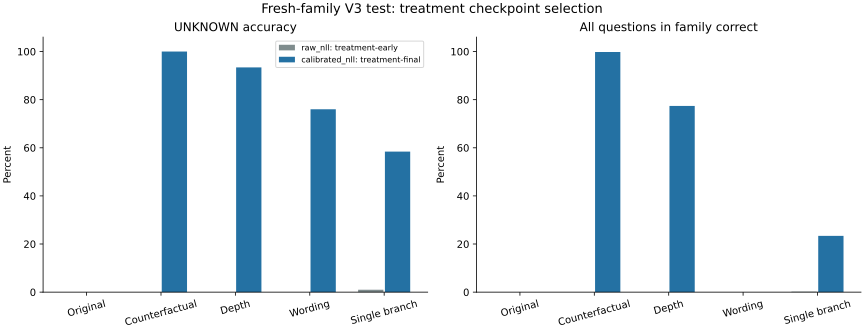
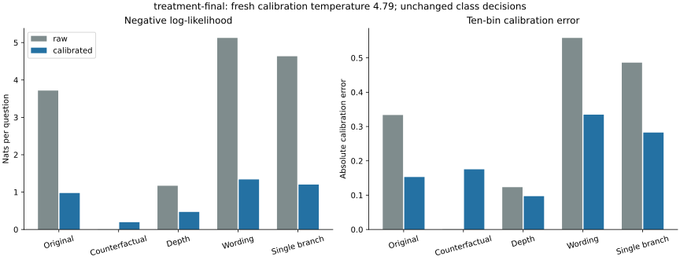

# V3 results: checkpoint selection and calibration

Frozen protocol: `d9e5cc5a734ee7c7da6975d434a9e46c2be98215e3418bdc35fdaa79a7c58d16`.

Four retained checkpoints, two per arm; one training seed; no additional training. Fresh families exclude every recorded V1/V2 canonical world. This compares the retained early/final pool, not the full trajectory.

## Selection on fresh development families

Temperatures in this table are fitted on selection-fit, then scored on distinct selection families.

| Candidate | Step | Accuracy | Raw NLL | Selection-fit temperature | Calibrated selection NLL |
| --- | ---: | ---: | ---: | ---: | ---: |
| control-early | 250 | 34.58% | 1.1051 | 2.2047 | 1.0976 |
| control-final | 1878 | 47.75% | 1.8251 | 6.0644 | 0.9475 |
| treatment-early | 250 | 33.42% | 1.1150 | 54.2251 | 1.0986 |
| treatment-final | 1878 | 83.33% | 1.8612 | 4.7778 | 0.5848 |

| Arm | Raw-NLL choice | Calibrated-NLL choice | Accuracy choice |
| --- | --- | --- | --- |
| control | control-early | control-final | control-final |
| treatment | treatment-early | treatment-final | treatment-final |

## Primary result

Treatment calibrated-NLL selection minus raw-NLL selection: **100.00 percentage points** in UNKNOWN accuracy on 1,000 fresh counterfactual families; paired family-bootstrap 95% interval **[100.00, 100.00]** percentage points.

This interval describes test-family sampling uncertainty for these fixed weights. It does not measure training-seed uncertainty, and a zero-width interval does not establish general equivalence.

## Every retained candidate on fresh tests

All temperatures below come from the separate final-calibration partition, after the choices were frozen. Unselected candidate results are diagnostic only.

| Candidate | Suite | Accuracy | UNKNOWN accuracy | All-family correct | Raw NLL | Calibrated NLL | Raw ECE | Calibrated ECE |
| --- | --- | ---: | ---: | ---: | ---: | ---: | ---: | ---: |
| control-early | original | 36.07% | 8.10% | 0.00% | 1.0906 | 1.0931 | 0.0418 | 0.0078 |
| control-early | counterfactual | 33.37% | 0.00% | 0.00% | 1.1152 | 1.0999 | 0.0704 | 0.0197 |
| control-early | depth | 33.33% | 0.20% | 0.00% | 1.1114 | 1.0997 | 0.0623 | 0.0176 |
| control-early | wording | 33.13% | 0.00% | 0.00% | 1.1087 | 1.0993 | 0.0522 | 0.0164 |
| control-early | single_branch | 25.70% | 1.20% | 0.40% | 1.1349 | 1.1070 | 0.1339 | 0.0925 |
| control-final | original | 65.70% | 100.00% | 35.00% | 0.4633 | 0.6505 | 0.0185 | 0.1162 |
| control-final | counterfactual | 33.43% | 0.00% | 0.00% | 3.1824 | 1.2427 | 0.1787 | 0.1046 |
| control-final | depth | 32.93% | 16.60% | 0.00% | 3.4722 | 1.2533 | 0.2613 | 0.1407 |
| control-final | wording | 33.93% | 88.40% | 0.00% | 5.4031 | 1.3387 | 0.5925 | 0.3082 |
| control-final | single_branch | 46.40% | 83.20% | 2.80% | 4.5117 | 1.1867 | 0.4430 | 0.1869 |
| treatment-early | original | 33.33% | 0.00% | 0.00% | 1.1151 | 1.0986 | 0.0769 | 0.0038 |
| treatment-early | counterfactual | 33.33% | 0.00% | 0.00% | 1.1151 | 1.0986 | 0.0768 | 0.0038 |
| treatment-early | depth | 33.33% | 0.00% | 0.00% | 1.1122 | 1.0986 | 0.0715 | 0.0035 |
| treatment-early | wording | 33.33% | 0.00% | 0.00% | 1.1131 | 1.0986 | 0.0670 | 0.0034 |
| treatment-early | single_branch | 25.50% | 1.00% | 0.20% | 1.1372 | 1.1001 | 0.1372 | 0.0813 |
| treatment-final | original | 66.63% | 0.00% | 0.00% | 3.7176 | 0.9753 | 0.3335 | 0.1529 |
| treatment-final | counterfactual | 99.93% | 100.00% | 99.80% | 0.0049 | 0.1948 | 0.0006 | 0.1753 |
| treatment-final | depth | 87.53% | 93.40% | 77.40% | 1.1703 | 0.4691 | 0.1233 | 0.0971 |
| treatment-final | wording | 43.40% | 76.00% | 0.00% | 5.1244 | 1.3391 | 0.5581 | 0.3346 |
| treatment-final | single_branch | 51.00% | 58.40% | 23.40% | 4.6339 | 1.2024 | 0.4861 | 0.2825 |

## Final calibration

| Candidate | Temperature | At bound | Calibration raw NLL | Calibration fitted NLL |
| --- | ---: | --- | ---: | ---: |
| control-early | 3.49321 | False | 1.1054 | 1.0973 |
| control-final | 5.99950 | False | 1.8103 | 0.9446 |
| treatment-early | 19.65268 | False | 1.1148 | 1.0986 |
| treatment-final | 4.79268 | False | 1.8820 | 0.5882 |

## Paired policy comparisons

Differences below are percentage points for accuracy and family correctness; NLL differences are nats/question. Negative NLL differences are improvements. Full family-bootstrap intervals for all suites are in v3-evidence/statistics.json.

| Comparison | Counterfactual UNKNOWN gain | Overall gain | All-family gain | Calibrated NLL difference |
| --- | ---: | ---: | ---: | ---: |
| control:calibrated_nll-minus-raw_nll | 0.00 | 0.07 | 0.00 | 0.1428 |
| control:accuracy-minus-raw_nll | 0.00 | 0.07 | 0.00 | 0.1428 |
| treatment:calibrated_nll-minus-raw_nll | 100.00 | 66.60 | 99.80 | -0.9038 |
| treatment:accuracy-minus-raw_nll | 100.00 | 66.60 | 99.80 | -0.9038 |
| raw_nll:treatment-minus-control | 0.00 | -0.03 | 0.00 | -0.0014 |
| calibrated_nll:treatment-minus-control | 100.00 | 66.50 | 99.80 | -1.0479 |
| accuracy:treatment-minus-control | 100.00 | 66.50 | 99.80 | -1.0479 |

## Interpretation

The late treatment checkpoint's fresh counterfactual accuracy is 99.93%; UNKNOWN accuracy is 100.00%; complete-family accuracy is 99.80%. Both calibrated-NLL and accuracy selection recover that same retained checkpoint. The earlier raw-NLL selection discarded useful late decisions because unscaled overconfident errors dominated the NLL objective.

Generalization remains limited: original-style UNKNOWN accuracy is 0.00%, wording accuracy is 43.40%, and single-branch accuracy is 51.00%. These failures remain after calibration, which leaves the predicted class unchanged.

The temperature fitted on the original/counterfactual mixture improves confidence metrics on several difficult suites, but worsens the already excellent counterfactual raw NLL from 0.0049 to 0.1948, and ECE from 0.0006 to 0.1753. A single mixture-fitted temperature is not a guarantee of calibration within every subdistribution. Confidence adjustments must be evaluated on the deployment distribution.

The primary empirical bootstrap interval collapses because every observed parent has the same paired UNKNOWN difference. Resampling this finite set cannot reveal unobserved failure types; it does not imply a guaranteed population improvement or perfect generalization.

## What this establishes

Checkpoint selection can change decisions; scalar temperature scaling cannot. Read the changes in accuracy separately from changes in confidence. Calibration lowers fitted NLL by construction, but fresh-test calibration metrics and transfer-suite metrics are the relevant checks.

This is a follow-up motivated by observed V2 behavior, with one training seed, a restricted candidate pool, shared synthetic motifs, and mechanically rendered language. It is not a general decision-model benchmark or a replication across seeds. Exact-world exclusion does not exclude isomorphic structures. Confidence fitted on one mixture may fail under wording, proof-depth, or single-branch shift. Secondary comparisons are descriptive without multiplicity correction.

See docs/V3_PROTOCOL.md for the predeclared design, v3-evidence for compact records, and local runs/study-v3 for every raw prediction and input.
