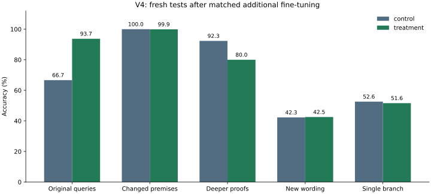

# V4 results: mixed UNKNOWN training

Frozen protocol: `2ab1532953c1f8b4c2dfaab8d1b3a49ddc39a32cbeeff5e5413e6ed55a631650`.

Both arms started from identical retained V3 treatment-final weights and used fresh optimizers, matched exposure, and a single additional-training seed. Control used changed-premise examples; treatment replaced approximately half with original-style query/entity-varied triples. This evaluates the complete training-mixture intervention.

| Arm | Calibrated-NLL selected update | Presentations at selection | Final temperature |
| --- | ---: | ---: | ---: |
| control | 1878 | 60003 | 6.03432 |
| treatment | 1878 | 60003 | 1.13004 |

| Arm | Suite | Accuracy | UNKNOWN accuracy | Complete-family accuracy | Raw NLL | Calibrated NLL | Raw ECE | Calibrated ECE |
| --- | --- | ---: | ---: | ---: | ---: | ---: | ---: | ---: |
| control | test_original | 66.67% | 0.00% | 0.00% | 4.7227 | 0.9784 | 0.3333 | 0.1556 |
| control | test_counterfactual | 100.00% | 100.00% | 100.00% | 0.0000 | 0.1899 | 0.0000 | 0.1729 |
| control | test_depth | 92.33% | 92.60% | 84.60% | 0.8012 | 0.3466 | 0.0754 | 0.1349 |
| control | test_wording | 42.27% | 66.00% | 0.00% | 6.3425 | 1.3298 | 0.5704 | 0.3386 |
| control | test_single_branch | 52.60% | 57.20% | 28.40% | 5.7858 | 1.1862 | 0.4728 | 0.2731 |
| treatment | test_original | 93.73% | 81.50% | 81.40% | 0.1970 | 0.1894 | 0.0303 | 0.0196 |
| treatment | test_counterfactual | 99.90% | 100.00% | 99.70% | 0.0305 | 0.0394 | 0.0254 | 0.0340 |
| treatment | test_depth | 80.00% | 94.80% | 66.60% | 1.6449 | 1.4662 | 0.1810 | 0.1791 |
| treatment | test_wording | 42.53% | 73.40% | 0.00% | 4.8859 | 4.3368 | 0.5394 | 0.5317 |
| treatment | test_single_branch | 51.60% | 91.40% | 8.80% | 4.0260 | 3.5683 | 0.4700 | 0.4668 |

Primary unsupported-query UNKNOWN gain: **81.50 percentage points**, paired family-bootstrap 95% interval **[79.10, 83.80]**.

Changed-premise UNKNOWN gain: **0.00 percentage points**, interval **[0.00, 0.00]**.

Primary positive-gain gate passed: **True**. Changed-premise -2 percentage-point noninferiority gate passed: **True**.

These are predeclared engineering gates, without a formal power calculation. Intervals concern family sampling for fixed models, not training-seed uncertainty. A collapsed empirical interval cannot establish perfect population generalization.

## Every selection candidate

Temperatures are fitted on selection-fit and scored on separate selection families. Final calibration is distinct; test scoring starts only after freezing selection.

| Candidate | Selection accuracy | Raw NLL | Calibrated NLL | Fit temperature |
| --- | ---: | ---: | ---: | ---: |
| control-step0 | 83.25% | 1.8641 | 0.5852 | 4.75730 |
| control-step250 | 83.33% | 2.2135 | 0.5961 | 5.59442 |
| control-step750 | 83.33% | 2.1813 | 0.5881 | 5.54053 |
| control-step1250 | 83.33% | 2.3210 | 0.5856 | 5.92171 |
| control-step1878 | 83.33% | 2.3600 | 0.5841 | 6.02882 |
| treatment-step0 | 83.25% | 1.8641 | 0.5852 | 4.75730 |
| treatment-step250 | 83.25% | 0.4412 | 0.4255 | 0.72060 |
| treatment-step750 | 91.83% | 0.2433 | 0.2432 | 1.02172 |
| treatment-step1250 | 96.50% | 0.1293 | 0.1290 | 1.03906 |
| treatment-step1878 | 96.58% | 0.1161 | 0.1162 | 1.05727 |

## Limits

Exact-world exclusion does not exclude shared abstract motifs. The original-style UNKNOWN generator, query positions, mechanically rendered English, and restricted rule language can still admit shortcuts. Improved accuracy is evidence about the evaluated distributions, not a proven entity-binding mechanism or a general decision engine. Architecture, loss, wording augmentation, and rule curriculum were not changed between arms. Transfer comparisons are descriptive; they are not multiplicity-adjusted. Temperature scaling cannot change labels, and its confidence metrics may worsen under distribution shift.

See [controlled diagnostics](V4_DIAGNOSTICS.md), [frozen protocol](../docs/V4_PROTOCOL.md), and local `runs/study-v4` for all inputs, predictions, and operational records.

## Post-test interpretation

This interpretation and label breakdown were added after the frozen analysis. They do not change the selected models, primary endpoints, or engineering gates.

The mixture closes much of the targeted gap: original-query UNKNOWN improves from 0/1,000 to 815/1,000. Original-query overall accuracy improves from 2,000/3,000 to 2,812/3,000; 814/1,000 complete families are correct. Changed-premise UNKNOWN remains 1,000/1,000 for both arms. Treatment gets 2,997/3,000 changed-premise questions and 997/1,000 complete families correct, versus 3,000/3,000 and 1,000/1,000 for control.

The targeted improvement comes with transfer limits. Depth accuracy falls from 1,385/1,500 to 1,200/1,500, even though depth UNKNOWN accuracy improves from 463/500 to 474/500. Wording remains weak: 634/1,500 for control and 638/1,500 for treatment; neither answers any complete wording family correctly. Single-branch accuracy falls from 526/1,000 to 516/1,000. Its label counts explain why improved UNKNOWN alone is insufficient:

| Single-branch subset | Control correct | Mixed-data correct |
| --- | ---: | ---: |
| Supported TRUE or FALSE | 240 / 500 | 59 / 500 |
| UNKNOWN | 286 / 500 | 457 / 500 |
| All questions | 526 / 1,000 | 516 / 1,000 |

The mixed model predicts UNKNOWN on 849/1,000 single-branch inputs, where only 500 oracle labels are UNKNOWN. This is observed behavior, not an identified internal mechanism. After calibration it still makes 745 wording errors and 460 single-branch errors with at least 90% confidence. Calibration on the training-style mixture does not make shifted inputs safe.

A shortcut concern was logged before testing: the generator assigns a unique selector predicate to one target entity and excludes that predicate from noise. Matching the queried entity to this distinguished target could solve many original-query cases without general proof binding. The next justified study would remove that cue and give multiple independently answerable entities different labels within the same world. V4 does not establish a general decision engine, nor does it justify changing architecture before improving that diagnostic. No further GPU study has been submitted.

Label counts and prediction hashes are retained in `runs/study-v4/posthoc-error-breakdown.json`; all raw logits remain available.

The remaining original-query UNKNOWN errors occur with both statement polarities: positive statements score 404/489 (85 errors), and negative statements score 411/511 (100 errors). This post-test breakdown does not support blaming negated statements alone. Counts and grouping are retained in `runs/study-v4/posthoc-polarity.json`.
