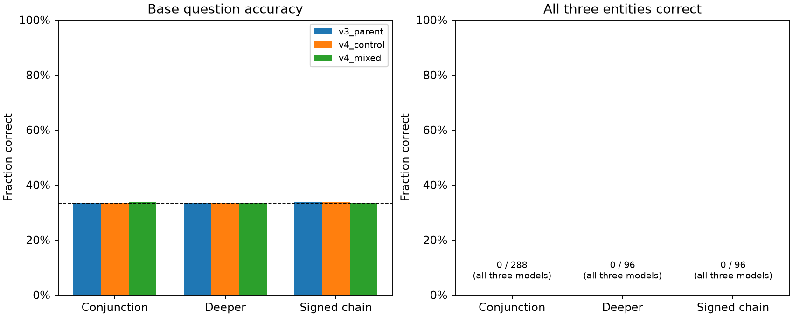

# V5: multi-entity diagnostic results

Inference-only study of three retained fixed heads. No training, model selection, temperature fitting, or new model release.

Protocol identity: `6038ac97693f50a8392825714fe48978e0072a3cee5ad05747290fb01bb4d4d8`. 480 diagnostic families, 12,960 questions per model, 38,880 prediction rows.

The central result is a failure: **all three models score zero complete base worlds across all 480 families**, with individual-question accuracy near one-third. In the main conjunction suite, the V4 mixed head predicts semantic UNKNOWN on **860/864** questions: TRUE recall **3/288**, FALSE recall **0/288**, UNKNOWN recall **288/288**. It makes **567/864** errors with at least 90% confidence even after applying its saved temperature. UNKNOWN here is a predicted semantic label, not confidence-based deferral. The V4 improvement remains valid on its original distribution, but does not transfer to these multi-entity worlds.

## Same world, different entities

Every base world contains one TRUE, one FALSE, and one UNKNOWN statement about the same predicate. Each query uses identical premises. Names, query slots, polarity and explicit fact counts are controlled. A constant predictor scores 33.33% accuracy and zero complete worlds.

| Model | Suite | Base correct / questions | Complete worlds | Constant predictions |
| --- | --- | ---: | ---: | ---: |
| v3_parent | conjunction | 288/864 (33.33%) | 0/288 | 285/288 |
| v3_parent | deeper | 96/288 (33.33%) | 0/96 | 94/96 |
| v3_parent | signed_chain | 97/288 (33.68%) | 0/96 | 95/96 |
| v4_control | conjunction | 289/864 (33.45%) | 0/288 | 287/288 |
| v4_control | deeper | 96/288 (33.33%) | 0/96 | 96/96 |
| v4_control | signed_chain | 97/288 (33.68%) | 0/96 | 95/96 |
| v4_mixed | conjunction | 291/864 (33.68%) | 0/288 | 284/288 |
| v4_mixed | deeper | 96/288 (33.33%) | 0/96 | 96/96 |
| v4_mixed | signed_chain | 96/288 (33.33%) | 0/96 | 96/96 |

Primary: V4 mixed complete-base-world accuracy on conjunction families is **0.00%**, parent-family bootstrap 95% interval [0.00%, 0.00%]. This describes fixed models and sampled generated families; there is no training-seed replication or pass/fail gate.

## Matched transformations

The table reports the V4 mixed model. Full model/suite/variant confusion matrices, confidence metrics, world counts and pair counts are in `runs/study-v5/analysis.json` and its compact evidence copy.

| Suite | Variant | Accuracy | Complete worlds | >=90% confidence errors after saved temperature |
| --- | --- | ---: | ---: | ---: |
| conjunction | base | 33.68% | 0/288 | 567/864 |
| conjunction | renamed | 33.56% | 0/288 | 568/864 |
| conjunction | reordered | 33.45% | 0/288 | 570/864 |
| conjunction | distractor | 33.33% | 0/288 | 574/864 |
| conjunction | negated_query | 33.45% | 0/288 | 568/864 |
| conjunction | wording | 33.33% | 0/288 | 576/864 |
| conjunction | remove_support | 60.76% | 1/288 | 310/864 |
| conjunction | reverse_support | 34.03% | 0/288 | 548/864 |
| conjunction | repair_unknown | 0.46% | 0/288 | 855/864 |
| deeper | base | 33.33% | 0/96 | 191/288 |
| deeper | renamed | 33.33% | 0/96 | 192/288 |
| deeper | reordered | 33.33% | 0/96 | 191/288 |
| deeper | distractor | 33.33% | 0/96 | 192/288 |
| deeper | negated_query | 33.33% | 0/96 | 191/288 |
| deeper | wording | 33.33% | 0/96 | 192/288 |
| deeper | remove_support | 64.93% | 0/96 | 99/288 |
| deeper | reverse_support | 33.33% | 0/96 | 188/288 |
| deeper | repair_unknown | 0.00% | 0/96 | 287/288 |
| signed_chain | base | 33.33% | 0/96 | 191/288 |
| signed_chain | renamed | 33.33% | 0/96 | 191/288 |
| signed_chain | reordered | 34.03% | 0/96 | 188/288 |
| signed_chain | distractor | 33.33% | 0/96 | 192/288 |
| signed_chain | negated_query | 32.99% | 0/96 | 191/288 |
| signed_chain | wording | 33.33% | 0/96 | 192/288 |
| signed_chain | remove_support | 63.54% | 0/96 | 99/288 |
| signed_chain | reverse_support | 33.33% | 0/96 | 189/288 |
| signed_chain | repair_unknown | 0.35% | 0/96 | 285/288 |

## Changes to one entity

Rates below separate response changes from correctness. Unaffected consistency can be high when both answers are wrong.

| Suite | Pair | Expected change/invariance | Both correct |
| --- | --- | ---: | ---: |
| conjunction | query_change | 8/864 | 3/864 |
| conjunction | renamed | 858/864 | 288/864 |
| conjunction | reordered | 859/864 | 288/864 |
| conjunction | distractor | 860/864 | 288/864 |
| conjunction | wording | 860/864 | 288/864 |
| conjunction | negated_query | 858/864 | 288/864 |
| conjunction | remove_support/target | 51/288 | 0/288 |
| conjunction | remove_support/unaffected | 574/576 | 288/576 |
| conjunction | reverse_support/target | 8/288 | 1/288 |
| conjunction | reverse_support/unaffected | 574/576 | 288/576 |
| conjunction | repair_unknown/unaffected | 574/576 | 3/576 |
| conjunction | repair_unknown/target | 0/288 | 0/288 |
| deeper | query_change | 0/288 | 0/288 |
| deeper | renamed | 288/288 | 96/288 |
| deeper | reordered | 288/288 | 96/288 |
| deeper | distractor | 288/288 | 96/288 |
| deeper | wording | 288/288 | 96/288 |
| deeper | negated_query | 288/288 | 96/288 |
| deeper | remove_support/target | 5/96 | 0/96 |
| deeper | remove_support/unaffected | 192/192 | 96/192 |
| deeper | reverse_support/target | 2/96 | 0/96 |
| deeper | reverse_support/unaffected | 192/192 | 96/192 |
| deeper | repair_unknown/unaffected | 192/192 | 0/192 |
| deeper | repair_unknown/target | 0/96 | 0/96 |
| signed_chain | query_change | 0/288 | 0/288 |
| signed_chain | renamed | 288/288 | 96/288 |
| signed_chain | reordered | 286/288 | 96/288 |
| signed_chain | distractor | 288/288 | 96/288 |
| signed_chain | wording | 288/288 | 96/288 |
| signed_chain | negated_query | 287/288 | 95/288 |
| signed_chain | remove_support/target | 9/96 | 0/96 |
| signed_chain | remove_support/unaffected | 192/192 | 96/192 |
| signed_chain | reverse_support/target | 1/96 | 0/96 |
| signed_chain | reverse_support/unaffected | 192/192 | 96/192 |
| signed_chain | repair_unknown/unaffected | 191/192 | 0/192 |
| signed_chain | repair_unknown/target | 0/96 | 0/96 |

## Preselected numerical example

The first conjunction family was selected before inference. Its base and support edits are shown even if they fail.

Facts: Bella is approved. Chen is ready. Bella is not enabled. Aman is enabled. Chen is approved. Aman is active. Bella is ready. Aman is approved. Chen is active.

Rules:

- For every person mentioned: if person 1 is approved and person 1 is not enabled, then person 1 is not authorized.
- For every person mentioned: if person 1 is authorized, then person 1 is registered.
- For every person mentioned: if person 1 is approved and person 1 is enabled, then person 1 is authorized.
- For every person mentioned: if person 1 is not authorized, then person 1 is not registered.

| Variant | Statement | Oracle | V4 mixed | Confidence with saved temperature |
| --- | --- | --- | --- | ---: |
| base | Aman is registered. | TRUE | UNKNOWN | 89.64% |
| base | Bella is registered. | FALSE | UNKNOWN | 92.62% |
| base | Chen is registered. | UNKNOWN | UNKNOWN | 91.60% |
| remove_support | Aman is registered. | UNKNOWN | FALSE | 79.38% |
| remove_support | Bella is registered. | FALSE | UNKNOWN | 93.13% |
| remove_support | Chen is registered. | UNKNOWN | UNKNOWN | 92.92% |
| reverse_support | Aman is registered. | FALSE | FALSE | 61.19% |
| reverse_support | Bella is registered. | FALSE | UNKNOWN | 91.92% |
| reverse_support | Chen is registered. | UNKNOWN | UNKNOWN | 92.27% |
| repair_unknown | Aman is registered. | TRUE | UNKNOWN | 97.33% |
| repair_unknown | Bella is registered. | FALSE | UNKNOWN | 98.73% |
| repair_unknown | Chen is registered. | TRUE | UNKNOWN | 98.88% |

## Interpretation and next experiment

These are behavioral tests, not evidence of an internal reasoning mechanism. The generator remains small, unary, and templated; all three labels co-occur, and fillers or missing branch facts can provide cues. Deeper/signed-chain results do not reproduce the earlier transfer generators. Removal/repair conditions have different class proportions. Stored temperatures are transferred without fitting and need not calibrate this distribution. Paired contrasts are descriptive and not adjusted for multiple comparisons. Collapsed bootstrap intervals do not prove population perfection.

The mixed head does not establish reliable complete-world decisions here. The next justified training experiment is a matched continuation comparing the existing curriculum with a mixture of independently answerable multi-entity worlds. Use fresh training/selection/test families, keep initialization and exposure matched, and retain earlier transfer checks. V5 diagnostic labels must not become a reused confirmatory test after training on these examples. An architecture change needs a separate concrete hypothesis and baseline.

See [the V6 training proposal](../docs/V6_PROPOSAL.md). It is not a frozen or submitted experiment.

## Evidence and operations

Read [the frozen protocol](../docs/V5_PROTOCOL.md), [the running journal](../RESEARCH_LOG.md), and [operation receipts](v5-evidence/inventory.json). Raw inputs, proof closures, logits and logs remain in `runs/study-v5`; source archives are in `artifacts/v5-source-snapshot`. Costs and cleanup are reported by separate timestamped receipts. New V5 work is local, uncommitted and unpushed; earlier V1–V4 remote backups remain intact.

Both GPU calls completed without a failed call or retry; all models passed 8/8 pilot GPU reference checks. The final audit reconciled all 38,880 prediction rows and verified 106 historical scientific/build files unchanged. The complete CPU suite passed 99 tests in 29.86 seconds.

At 2026-10-13T14:34:11.317978Z, the billing report attributes **$0.21995289** to the two owned V5 apps: L4 $0.13866666, CPU $0.03625556, memory $0.04443078, egress $0.00059989. Both apps appear in the report. Workspace billed charges are **$0**. This is observed metering, not a final invoice; the $0.6447368888888889 submitted compute ceiling and unused recovery/storage reserves are separate budget records. A prior report omitted the current hour and returned no owned rows; that observation is preserved and is not evidence of free execution.

At 2026-10-13T14:33:50.402949Z, direct lifecycle/task checks verified both apps stopped with zero tasks, and the owned Volume was absent after deletion. Initial cleanup failed on an already-stopped app; the next helper hung because it crossed SDK event loops. Only that owned local process was terminated, and the corrected helper passed direct checks on the SDK's own loop. These operational fixes changed no data, model, scientific source or prediction row. Failure logs and helper snapshots remain retained.
