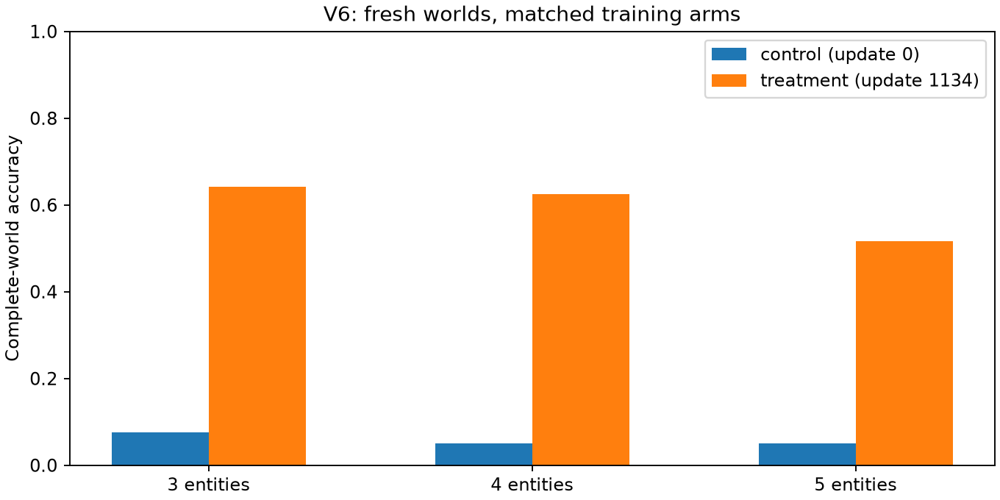

# V6: matched multi-entity training results

Replacing half the old curriculum with multi-entity worlds improved complete-world accuracy from **21/360 (5.83%) to 214/360 (59.44%)**. Primary question accuracy rose from **481/1,440 (33.40%) to 1,231/1,440 (85.49%)**. Both predeclared engineering checks pass for this one matched seed pair.

The remaining failure is sensitivity to changes within the same world: only **9/360 families (2.50%)** are fully correct across all eight transformations. On the local support-edit target, both before/after answers are correct in **213/360** forward and **225/360** inverse cases. Different-entity/different-label pairs have both answers correct in **766/1,227**, versus **10/1,227** for control. These observations show improved query-dependent decisions without establishing an internal reasoning mechanism.

Old-style wording and single-branch accuracy remain **46.67% and 51.00%**; treatment makes **122/300 and 76/200** errors with at least 90% calibrated confidence on those suites. Global calibration does not make every transfer distribution reliable.

Single-seed continuation from the same pinned V4 mixed head; 36,288 presentations and 1,134 updates per arm.

Input-token exposure: control 7,615,419; treatment 7,955,055 (4.46% more). The final trajectory audit reconciles these totals against every update.

Active amended protocol: `099611c7f4eb70c9bc12f2fd44d0279c5bfc81e0cf0913b6e5d5e0035b3f44af`. Selection identity: `8b06abd1ab7318e67385435fb8311013f2524574f6dc44b946528f2e55f291e1`.

Primary complete-world treatment-minus-control gain: **53.61 percentage points**, 95% blocked bootstrap interval **[48.61, 58.34] points** across 360 worlds and 120 label-rotation blocks.

The primary test varies label composition. Unlike V5, a constant class can correctly answer some homogeneous worlds. Compare the arms on these fresh, paired inputs; their complete-world rates are not directly comparable with V5's one-of-each construction.

## Selected checkpoints

| Arm | Update | Calibrated selection NLL | Final temperature |
| --- | ---: | ---: | ---: |
| control | 0 | 0.890487 | 6.551343 |
| treatment | 1134 | 0.181570 | 1.190516 |

The selected control is the unchanged starting model: all four trained control candidates have worse calibrated selection NLL. Both arms completed the same training exposure, but this primary comparison is between the **selected pipelines**, not two terminal checkpoints. The parent and selected-control raw predictions are identical on all three shared baseline tests; their temperatures differ.

## Fresh tests

| Test | Control accuracy | Treatment accuracy | Control complete families | Treatment complete families |
| --- | ---: | ---: | ---: | ---: |
| test_multi | 33.40% | 85.49% | 5.83% | 59.44% |
| test_multi_transformations | 33.55% | 81.68% | 0.00% | 2.50% |
| test_multi_depth | 33.33% | 84.26% | 6.48% | 57.41% |
| test_multi_wording | 33.10% | 77.55% | 7.41% | 44.44% |
| test_multi_signed_chain | 32.87% | 85.42% | 6.48% | 57.41% |
| test_original | 91.11% | 92.11% | 73.67% | 76.33% |
| test_counterfactual | 100.00% | 99.67% | 100.00% | 99.00% |
| test_depth | 79.67% | 80.67% | 65.00% | 67.00% |
| test_wording | 42.33% | 46.67% | 0.00% | 7.00% |
| test_single_branch | 50.00% | 51.00% | 7.00% | 11.00% |

Complete families for transformations require every included variant and entity query to be correct; base complete worlds use only test_multi. Transfers have distinct generators and are descriptive.

## World size

| Entities | Control complete worlds | Treatment complete worlds |
| --- | ---: | ---: |
| 3 | 9/120 | 77/120 |
| 4 | 6/120 | 75/120 |
| 5 | 6/120 | 62/120 |

## Confidence and old behavior

| Arm | Test | UNKNOWN accuracy | Wrong with raw confidence ≥90% | Wrong with final-calibrated confidence ≥90% |
| --- | --- | ---: | ---: | ---: |
| control | test_multi | 98.33% | 928/1440 | 0/1440 |
| control | test_original | 73.67% | 51/900 | 0/900 |
| control | test_counterfactual | 100.00% | 0/900 | 0/900 |
| control | test_multi_depth | 99.31% | 283/432 | 0/432 |
| control | test_multi_wording | 99.31% | 288/432 | 0/432 |
| control | test_multi_signed_chain | 97.92% | 286/432 | 0/432 |
| treatment | test_multi | 81.88% | 8/1440 | 5/1440 |
| treatment | test_original | 76.33% | 57/900 | 50/900 |
| treatment | test_counterfactual | 100.00% | 0/900 | 0/900 |
| treatment | test_multi_depth | 84.72% | 6/432 | 5/432 |
| treatment | test_multi_wording | 93.06% | 23/432 | 9/432 |
| treatment | test_multi_signed_chain | 81.94% | 5/432 | 1/432 |

Treatment-minus-unchanged-parent UNKNOWN accuracy on test_original: 2.67%, 95% parent-family interval [0.33%, 5.33%].

Treatment-minus-unchanged-parent UNKNOWN accuracy on test_counterfactual: 0.00%, 95% parent-family interval [0.00%, 0.00%].

Predeclared engineering checks: {"both_parent_unknown_retention_intervals_within_margin": true, "primary_gain_interval_excludes_zero": true, "retention_unknown_margin": 0.02}.

UNKNOWN is a semantic label; temperature changes confidence, not the selected class. Full confusion matrices, NLL, Brier, ECE and class counts are retained in evaluation.json.

## Entity changes and transformations

| Arm | Pair | Expected response | Both answers correct |
| --- | --- | ---: | ---: |
| control | renamed | 1404/1440 | 468/1440 |
| control | reordered | 1394/1440 | 464/1440 |
| control | distractor | 1408/1440 | 468/1440 |
| control | negated_query | 1418/1440 | 473/1440 |
| control | wording | 1417/1440 | 473/1440 |
| control | support_edit/target | 3/360 | 2/360 |
| control | support_edit_inverse/target | 2/360 | 2/360 |
| control | support_edit/unaffected | 1050/1080 | 350/1080 |
| control | support_edit_inverse/unaffected | 1051/1080 | 351/1080 |
| control | different_entity_different_label | 43/1227 | 10/1227 |
| treatment | renamed | 1330/1440 | 1170/1440 |
| treatment | reordered | 1157/1440 | 1093/1440 |
| treatment | distractor | 1003/1440 | 918/1440 |
| treatment | negated_query | 1206/1440 | 1107/1440 |
| treatment | wording | 1145/1440 | 1023/1440 |
| treatment | support_edit/target | 215/360 | 213/360 |
| treatment | support_edit_inverse/target | 226/360 | 225/360 |
| treatment | support_edit/unaffected | 905/1080 | 847/1080 |
| treatment | support_edit_inverse/unaffected | 889/1080 | 834/1080 |
| treatment | different_entity_different_label | 922/1227 | 766/1227 |

Expected responses include label equivariance under negation/support edits and invariance under renaming or unrelated changes. High consistency can reflect two wrong answers.

## Preselected example

Family v6-test_multi-multi-3-0000-0 was selected before inference. It has a homogeneous base composition; it is retained as specified.

Facts: Chen is approved. Aman is verified. Bella is verified. Bella is enabled. Chen is verified. Aman is enabled. Aman is approved. Bella is ready. Chen is enabled.

Rules:

- For every person mentioned: if person 1 is enabled and person 1 is verified, then person 1 is trusted.
- For every person mentioned: if person 1 is enabled and person 1 is not verified, then person 1 is not trusted.

| Variant | Statement | Oracle | Control | Treatment | Treatment calibrated confidence |
| --- | --- | --- | --- | --- | ---: |
| base | Aman is trusted. | TRUE | UNKNOWN | TRUE | 83.26% |
| base | Bella is trusted. | TRUE | UNKNOWN | TRUE | 89.50% |
| base | Chen is trusted. | TRUE | UNKNOWN | TRUE | 86.47% |
| support_edit | Aman is trusted. | UNKNOWN | UNKNOWN | TRUE | 79.26% |
| support_edit | Bella is trusted. | TRUE | UNKNOWN | TRUE | 85.87% |
| support_edit | Chen is trusted. | TRUE | UNKNOWN | TRUE | 86.72% |
| support_edit_inverse | Aman is trusted. | FALSE | UNKNOWN | FALSE | 73.43% |
| support_edit_inverse | Bella is trusted. | TRUE | UNKNOWN | TRUE | 99.83% |
| support_edit_inverse | Chen is trusted. | TRUE | UNKNOWN | TRUE | 99.37% |

Changes to this preselected world's facts:

- support_edit: removed ['Aman is verified.']; added ['Aman is ready.'].
- support_edit_inverse: removed ['Aman is verified.']; added ['Aman is not verified.'].

## Post hoc edit breakdown

These six descriptive slices use existing test logits, were added after the frozen analysis, and do not change selection, endpoints or the engineering checks. Each direction has 120 target pairs. Counts reconcile exactly with the frozen aggregate target-edit checks.

| Edit | Control both correct | Treatment both correct | Treatment edited answer correct |
| --- | ---: | ---: | ---: |
| support_edit/FALSE->TRUE | 0/120 | 83/120 | 105/120 |
| support_edit/TRUE->UNKNOWN | 2/120 | 68/120 | 80/120 |
| support_edit/UNKNOWN->FALSE | 0/120 | 62/120 | 87/120 |
| support_edit_inverse/FALSE->UNKNOWN | 2/120 | 68/120 | 93/120 |
| support_edit_inverse/TRUE->FALSE | 0/120 | 84/120 | 94/120 |
| support_edit_inverse/UNKNOWN->TRUE | 0/120 | 73/120 | 97/120 |

TRUE-to-UNKNOWN edits have the lowest edited-question accuracy here (80/120); UNKNOWN-to-FALSE pairs have the lowest both-answer accuracy (62/120). The base answer is already wrong on some pairs. This distinguishes a failure to recognize the original evidence from a failure to react to its change.

## Limits and evidence

This tests a curriculum change for one matched seed pair. Entity count, rule mixture and token exposure also differ; it does not identify an internal binding mechanism. Label-rotation blocks and world splits prevent recorded canonical overlap, not all abstract-skeleton overlap. Fillers/missing branch facts and templated wording can provide cues. The two oracle audits share parsing and grounding utilities. Secondary comparisons are descriptive without multiplicity adjustment; collapsed intervals are not population guarantees.

Read [the protocol](../docs/V6_PROTOCOL.md), [the journal](../RESEARCH_LOG.md), and [compact evidence](v6-evidence/inventory.json). Raw data, logits and trajectories remain in runs/study-v6. Scheduled weights are retained through pinned private HF storage, with selected bundles local and privately verified. Costs and cleanup have separate timestamped receipts. No Git commit or push is part of this study.

## Numerical audit

The original Linux-worker metrics remain unchanged. Independent Mac CPU recomputation matches every decision/count. Ordinary float differences are accepted only within an absolute 1e-12 tolerance. Three AURC values on the transformation suite differ by up to 6.02e-7 because nearly tied confidence scores can sort differently across platforms. Each recorded value lies inside the explicit minimum/maximum AURC from ordering errors within confidence groups spanning at most 32 float64 epsilons (about 7.11e-15); order across groups remains fixed. Rejection tests cover altered counts, nonroundoff scores and AURC outside the permitted order bounds. Full difference and validation receipts are preserved; no reported metric, frozen analysis, model or endpoint was replaced.

## Verified artifacts, cost and closure

All **69,208 prediction rows in 55 files** were checked against the frozen inputs and inventories. Trajectories reconcile all 1,134 updates, 36,288 presentations and token totals for each arm. The final CPU suite passed **110 tests** in 50.05 seconds. The original 250 control updates and partial export assets are preserved and verified. V4 scientific/build files (90 checked) and V5 frozen models/data plus 137 historical scientific/report files remain unchanged; those inventories overlap and are not additive.

Both selected bundles passed GPU reload checks and all eight FP32 reference inputs after fresh pinned private-Hub downloads on CPU.

| Bundle | Private repository | Pinned commit |
| --- | --- | --- |
| control | [axondendriteplus/decision-lab-v6-smollm2-360m-control](https://huggingface.co/axondendriteplus/decision-lab-v6-smollm2-360m-control) | `cde5272c428ecad79b07b374361c1e46c3dd2c30` |
| treatment | [axondendriteplus/decision-lab-v6-smollm2-360m-multi-entity](https://huggingface.co/axondendriteplus/decision-lab-v6-smollm2-360m-multi-entity) | `07d879161e56969669e699f4e5c2b4cc0a70f077` |

All ten scheduled candidate entries are retained: eight trained weight files in [axondendriteplus/decision-lab-v6-checkpoints](https://huggingface.co/axondendriteplus/decision-lab-v6-checkpoints) at `eb6869a4265e3155f37b15fe8a78f8d04a13b440`, plus two aliases to the pinned V4 parent. Additional weights were verified by pinned remote LFS size/SHA metadata; no intermediate inference verification is claimed. Selected weights and inference bundles remain local as well.

Observed owned V6 metering is **$1.75521017** at `2026-10-13T18:16:58.148492+00:00`, with **$0 billed**. The original compute reservation ceiling was $3.8359077778 under a $4 allocation, with a separate $0.50 storage/egress reserve. The reported observation is scoped to owned app/Volume IDs, can lag and is not a final invoice. Workspace gross metering is $13.41010451, leaving a conservative $16.58989549 margin against the original $30 budget; that is not a live-wallet balance.

Cleanup at `2026-10-13T18:16:49.091184+00:00` verified all six owned apps stopped with zero tasks, then deleted only the recorded V6 Volume. All unrelated resources were left alone. One failed GPU packaging call, the successful reserved saved-state recovery, the DNS-interrupted artifact download, initial failed audit fixture and numerical-audit corrections remain recorded separately.

The full journal, compact evidence, and final independently checked source archive retain the work. The final source manifest and `runs/study-v6/closure-receipt.json` are external to the archive to avoid circular hashes. Full raw inputs/logits/trajectories remain local and are not included in the source archive or the earlier V1–V4 remote backup. Git implementation remains uncommitted and unpushed. [V7](../docs/V7_PROPOSAL.md) proposes fresh-seed replication before another objective or architecture; no new training has started.
