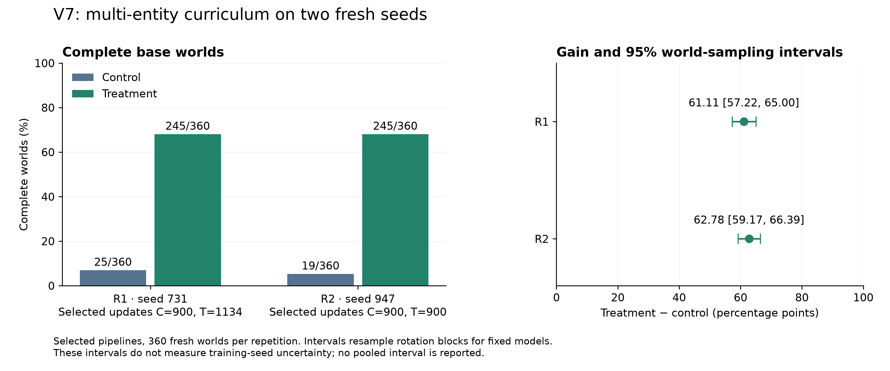

# V7: two fresh-seed replications

Both repetitions were frozen before submission. Each arm completed the same 36,288 question presentations and 1,134 updates from the pinned V4 mixed head; inputs and training seeds are fresh. Each result concerns selected pipelines, which may choose update zero.

| Repetition | Seed | Control complete worlds | Treatment complete worlds | Gain (points) | 95% world-sampling interval (points) |
| --- | ---: | ---: | ---: | ---: | --- |
| r1 | 731 | 25/360 | 245/360 | 61.11 | [57.22, 65.00] |
| r2 | 947 | 19/360 | 245/360 | 62.78 | [59.17, 66.39] |

Standalone exports: [PNG](V7_RESULTS.png), [PDF](V7_RESULTS.pdf). Both controls selected update 900; treatment selected 1,134 in r1 and 900 in r2. All terminal weights are retained; terminal-checkpoint test inference was not added after selection.

Replication checks: {"primary_gains_positive_in_both_repetitions": true, "all_engineering_checks_pass_in_both_repetitions": true}.

Descriptive mean contrast: 61.94 points. No pooled training-seed or population confidence interval is attached to two repetitions. Individual 95% intervals sample worlds for fixed models and are not a joint 95% guarantee. V6 is historical context, not an additional freshly tested seed.

## r1: selection and exposure

Protocol `f07e4f34618900fe4a571f47f380737efe7919897a5465704c92a138c3154c71`; selection `b6c7489a6a87c93f856b2ed53943d7636606ea7e5de0e33303963f9a48ecbfbc`.

| Arm | Selected update | Selection calibrated NLL | Final temperature | Input tokens across training |
| --- | ---: | ---: | ---: | ---: |
| control | 900 | 0.893826 | 7.476985 | 7,605,990 |
| treatment | 1134 | 0.183692 | 1.164712 | 7,967,358 |

| Test | Control accuracy | Treatment accuracy | Control complete families | Treatment complete families | Treatment calibrated confident errors |
| --- | ---: | ---: | ---: | ---: | ---: |
| test_multi | 33.19% | 87.92% | 6.94% | 68.06% | 4/1440 |
| test_multi_transformations | 33.40% | 83.64% | 0.00% | 11.94% | 481/11520 |
| test_multi_depth | 33.56% | 86.34% | 5.56% | 66.67% | 2/432 |
| test_multi_wording | 33.33% | 77.55% | 7.41% | 57.41% | 45/432 |
| test_multi_signed_chain | 33.56% | 84.26% | 5.56% | 60.19% | 5/432 |
| test_original | 93.56% | 93.11% | 80.67% | 79.33% | 57/900 |
| test_counterfactual | 100.00% | 99.67% | 100.00% | 99.00% | 2/900 |
| test_depth | 76.67% | 79.00% | 64.00% | 67.00% | 59/300 |
| test_wording | 43.00% | 41.67% | 0.00% | 1.00% | 143/300 |
| test_single_branch | 49.00% | 45.50% | 2.00% | 5.00% | 81/200 |

Confident errors use the saved final temperature and a 90% threshold. Complete transformation families require all variants and entity queries correct.

Treatment-minus-parent UNKNOWN on test_original: 4.67 points, paired 95% interval [2.33, 7.33].
Treatment-minus-parent UNKNOWN on test_counterfactual: 0.00 points, paired 95% interval [0.00, 0.00].

| Transformation pair | Treatment expected response | Treatment both correct |
| --- | ---: | ---: |
| renamed | 1388/1440 | 1242/1440 |
| reordered | 1219/1440 | 1152/1440 |
| distractor | 1051/1440 | 974/1440 |
| negated_query | 1344/1440 | 1218/1440 |
| wording | 1060/1440 | 1002/1440 |
| support_edit/target | 251/360 | 251/360 |
| support_edit_inverse/target | 264/360 | 264/360 |
| support_edit/unaffected | 929/1080 | 871/1080 |
| support_edit_inverse/unaffected | 871/1080 | 817/1080 |
| different_entity_different_label | 994/1242 | 871/1242 |

### Preselected example: v7-r1-test_multi-multi-3-0000-0

Facts: Bella is approved. Bella is verified. Chen is active. Chen is verified. Aman is approved. Bella is active. Aman is verified. Chen is approved. Aman is active.

Rules:

- For every person mentioned: if person 1 is approved and person 1 is not active, then person 1 is not registered.
- For every person mentioned: if person 1 is registered, then person 1 is trusted.
- For every person mentioned: if person 1 is approved and person 1 is active, then person 1 is registered.
- For every person mentioned: if person 1 is not registered, then person 1 is not trusted.

| Variant | Statement | Oracle | Treatment |
| --- | --- | --- | --- |
| base | Aman is trusted. | TRUE | TRUE |
| base | Bella is trusted. | TRUE | TRUE |
| base | Chen is trusted. | TRUE | TRUE |
| support_edit | Aman is trusted. | UNKNOWN | TRUE |
| support_edit | Bella is trusted. | TRUE | TRUE |
| support_edit | Chen is trusted. | TRUE | TRUE |
| support_edit_inverse | Aman is trusted. | FALSE | FALSE |
| support_edit_inverse | Bella is trusted. | TRUE | TRUE |
| support_edit_inverse | Chen is trusted. | TRUE | TRUE |

The support edit replaces “Aman is active.” with the irrelevant filler “Aman is enabled.” Approval alone cannot establish registration or trust, and no negative proof exists, so the answer becomes UNKNOWN. Treatment keeps TRUE with 53.56% calibrated confidence, down from 68.93% before the edit. Replacing active with explicitly not active instead establishes FALSE; treatment gets that reversal correct at 99.55% confidence. These confidences come from the saved logits and final temperature, without new inference.

## r2: selection and exposure

Protocol `94550cc844cb3a116a64211bac4be473610aa0b835f8b493f70b2478ab9f808f`; selection `a6d81855a856a370df162f26a78175a039eba56fc483e235097c6f75dc4a6edd`.

| Arm | Selected update | Selection calibrated NLL | Final temperature | Input tokens across training |
| --- | ---: | ---: | ---: | ---: |
| control | 900 | 0.896921 | 7.127094 | 7,612,725 |
| treatment | 900 | 0.180676 | 1.284139 | 7,971,462 |

| Test | Control accuracy | Treatment accuracy | Control complete families | Treatment complete families | Treatment calibrated confident errors |
| --- | ---: | ---: | ---: | ---: | ---: |
| test_multi | 33.40% | 86.53% | 5.28% | 68.06% | 7/1440 |
| test_multi_transformations | 33.54% | 82.96% | 0.00% | 10.00% | 363/11520 |
| test_multi_depth | 33.33% | 86.57% | 8.33% | 67.59% | 3/432 |
| test_multi_wording | 33.33% | 75.46% | 5.56% | 50.00% | 30/432 |
| test_multi_signed_chain | 33.33% | 86.81% | 6.48% | 65.74% | 4/432 |
| test_original | 93.89% | 93.78% | 81.67% | 81.67% | 46/900 |
| test_counterfactual | 100.00% | 99.56% | 100.00% | 98.67% | 1/900 |
| test_depth | 82.00% | 83.33% | 70.00% | 68.00% | 46/300 |
| test_wording | 44.00% | 51.33% | 0.00% | 3.00% | 117/300 |
| test_single_branch | 53.50% | 53.50% | 9.00% | 11.00% | 66/200 |

Confident errors use the saved final temperature and a 90% threshold. Complete transformation families require all variants and entity queries correct.

Treatment-minus-parent UNKNOWN on test_original: 6.33 points, paired 95% interval [3.67, 9.67].
Treatment-minus-parent UNKNOWN on test_counterfactual: -0.33 points, paired 95% interval [-1.00, 0.00].

| Transformation pair | Treatment expected response | Treatment both correct |
| --- | ---: | ---: |
| renamed | 1389/1440 | 1225/1440 |
| reordered | 1219/1440 | 1132/1440 |
| distractor | 1011/1440 | 934/1440 |
| negated_query | 1327/1440 | 1201/1440 |
| wording | 1130/1440 | 1027/1440 |
| support_edit/target | 245/360 | 245/360 |
| support_edit_inverse/target | 253/360 | 253/360 |
| support_edit/unaffected | 937/1080 | 864/1080 |
| support_edit_inverse/unaffected | 885/1080 | 817/1080 |
| different_entity_different_label | 1038/1290 | 894/1290 |

### Preselected example: v7-r2-test_multi-multi-3-0000-0

Facts: Aman is bright. Chen is round. Aman is round. Bella is round. Chen is blue. Chen is quiet. Bella is quiet. Aman is quiet. Bella is blue.

Rules:

- For every person mentioned: if person 1 is round and person 1 is not quiet, then person 1 is not warm.
- For every person mentioned: if person 1 is round and person 1 is quiet, then person 1 is warm.

| Variant | Statement | Oracle | Treatment |
| --- | --- | --- | --- |
| base | Aman is warm. | TRUE | TRUE |
| base | Bella is warm. | TRUE | TRUE |
| base | Chen is warm. | TRUE | TRUE |
| support_edit | Aman is warm. | UNKNOWN | TRUE |
| support_edit | Bella is warm. | TRUE | TRUE |
| support_edit | Chen is warm. | TRUE | TRUE |
| support_edit_inverse | Aman is warm. | FALSE | FALSE |
| support_edit_inverse | Bella is warm. | TRUE | TRUE |
| support_edit_inverse | Chen is warm. | TRUE | TRUE |

The support edit replaces “Aman is quiet.” with the irrelevant filler “Aman is blue.” The round fact establishes neither warm nor not warm without the missing quiet/not-quiet premise. Treatment nevertheless keeps TRUE at 71.48% calibrated confidence, versus 74.77% before the edit. Explicitly replacing quiet with not quiet yields FALSE, which treatment gets right at 99.16% confidence. Both preselected base examples happen to have three TRUE answers; they remain unchanged rather than being replaced with more favorable cases. The aggregate tests include different label compositions.

## Limits and evidence

These two fresh-seed comparisons preserve the V6 curriculum and selection procedure. Canonical world exclusion does not eliminate all abstract-skeleton overlap. Templates, fillers and missing branch facts remain possible cues; oracle audits share parsing/grounding utilities. Token exposure and other curriculum properties differ. Secondary transfers and entity checks are descriptive. The study does not establish general decision ability or identify an internal reasoning mechanism.

Read [the protocol](../docs/V7_PROTOCOL.md) and [the journal](../RESEARCH_LOG.md). Raw data, logits, trajectories and call/failure receipts are retained under runs/study-v7. Original worker metrics remain unchanged; cross-platform numeric audit uses the documented V6 roundoff/near-tie bounds. Selected private releases, costs, cleanup and source archival have separate verified receipts. Git changes remain local. No new robustness objective or architecture has been trained.

## Verified retention, private releases and closure

Both full audits verify 69,208 prediction rows across 55 files per repetition: **138,416 rows in 110 files** overall. Both independent raw-count audits pass, all 40 local test metric recomputations pass, and the closing CPU regression suite passes **119 tests in 71.21 seconds**. The separate preparation suite passed 119 tests in 71.05 seconds. Later operational tools were also exercised on retained artifacts; the test count is not a claim that every wrapper has unit coverage.

Aggregate test inference uses BF16 on L4. Export checks and fresh pinned-Hub reference checks use FP32; every selected bundle passes eight inputs on GPU and eight after its private-Hub CPU download. Verified duplicate weights remain complete, byte-identical bundles after hardlinking.

| Repetition | Arm | Private selected repository | Pinned revision |
| --- | --- | --- | --- |
| r1 | control | [axondendriteplus/decision-lab-v7-r1-smollm2-360m-control](https://huggingface.co/axondendriteplus/decision-lab-v7-r1-smollm2-360m-control) | `82620838100d55290e309e5c561d7827acd70507` |
| r1 | treatment | [axondendriteplus/decision-lab-v7-r1-smollm2-360m-multi-entity](https://huggingface.co/axondendriteplus/decision-lab-v7-r1-smollm2-360m-multi-entity) | `6aa3e01e41460dba7049c044906dc81fe4c7ba53` |
| r2 | control | [axondendriteplus/decision-lab-v7-r2-smollm2-360m-control](https://huggingface.co/axondendriteplus/decision-lab-v7-r2-smollm2-360m-control) | `df8e085ffd931fac19c4362d205e7bbf78b65501` |
| r2 | treatment | [axondendriteplus/decision-lab-v7-r2-smollm2-360m-multi-entity](https://huggingface.co/axondendriteplus/decision-lab-v7-r2-smollm2-360m-multi-entity) | `63d1df3c1648217398243b7b943a9d1cd7362ef0` |

All 20 candidate entries are retained: 16 additional trained weights plus four references to the unchanged original parent. Intermediate retention checks pinned remote LFS SHA/size metadata; it does not claim fresh intermediate inference. Full optimizer/RNG recovery states were temporary and were removed with the working Volume. Frozen inputs, raw logits, trajectories, scheduled model weights and selected inference bundles remain available.

r1 checkpoint store: [axondendriteplus/decision-lab-v7-r1-checkpoints](https://huggingface.co/axondendriteplus/decision-lab-v7-r1-checkpoints), final revision `844f06b3c2f06891b16dfc31fd43f2a9136d2ea5`.
r2 checkpoint store: [axondendriteplus/decision-lab-v7-r2-checkpoints](https://huggingface.co/axondendriteplus/decision-lab-v7-r2-checkpoints), final revision `f02056903ef00dc6402e29865103140448a5181d`.

At 2026-10-14T14:50:37.324652+00:00, observed V7 resource-ID-attributed metering is **$3.53624060**: L4 $2.27191716, CPU $0.53730993, memory $0.72701351. Workspace billed charges are **$0**. This is a metering snapshot, can lag and is not an invoice. The conservative workspace gross observation is $16.98010451, leaving $13.01989549 against the original $30 budget; this is not a live-wallet balance. The compute ceiling remains $7.6718155556 under an $8 allocation plus $1 storage/egress reserve. Submitted-call reservations total $7.2456804444; the unused r2 recovery allowance was never submitted.

Nineteen GPU call records remain: 18 completed and the initial pre-scoring r1 pilot failure. Its image omitted unchanged verifier files; the separately archived operational fix and reserved rerun passed. Scientific source, datasets and protocol identities were unchanged. No other V7 GPU failure or retry occurred. Both original pre-execution archives and all failure records remain preserved.

All nine owned apps were directly checked as stopped with zero tasks before and after deletion of only Volume `decision-model-lab-v7-runs` (`vo-n7C4eHw1NUOunUaS9dAIiJ`). Its absence was rechecked. Historical checks verify 262 prior scientific/report/build files, frozen models/data and exclusion registries unchanged. Two V6 duplicate weights and one V4 duplicate were hardlinked only after prior fresh verification and complete before/after bundle checks; their paths, contents and historical receipts remain unchanged. Unrelated resources/files/caches were untouched.

Source archives and complete raw V7 records remain local, outside the earlier V1–V4 remote backup. The final independent archive manifest and external closure receipt record completion without a circular journal/archive hash. Git changes remain local, uncommitted and unpushed.

Next is the separately reviewed [paired-loss proposal](../docs/V8_PROPOSAL.md). No V8 training, inference, dataset or allocation is submitted.
